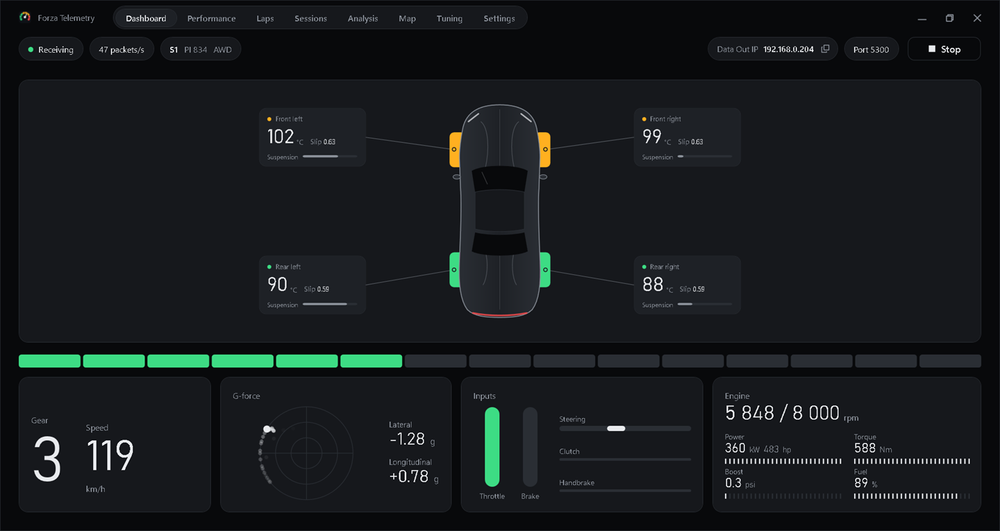
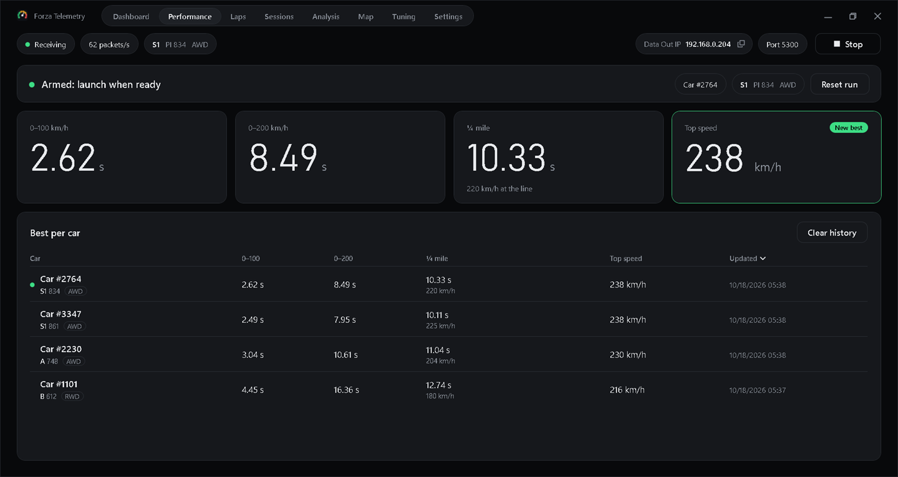
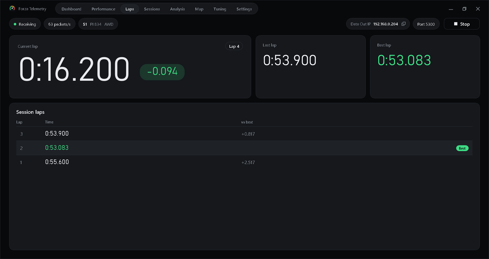
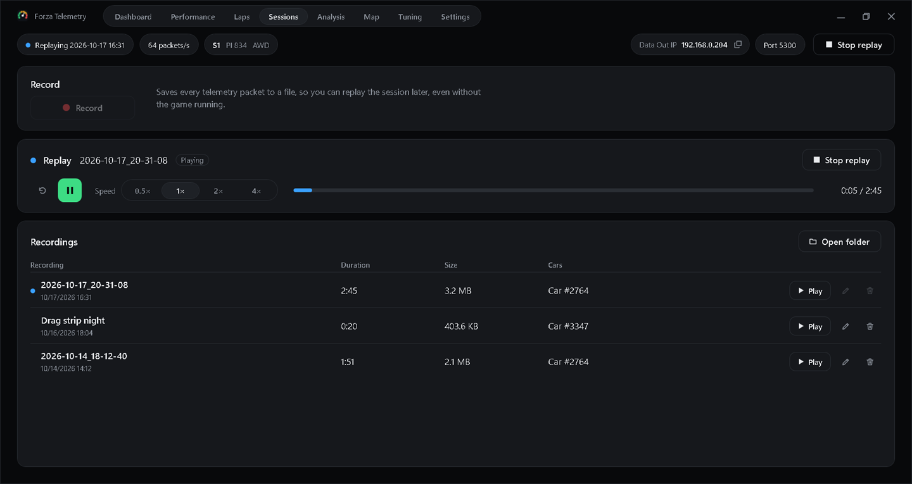
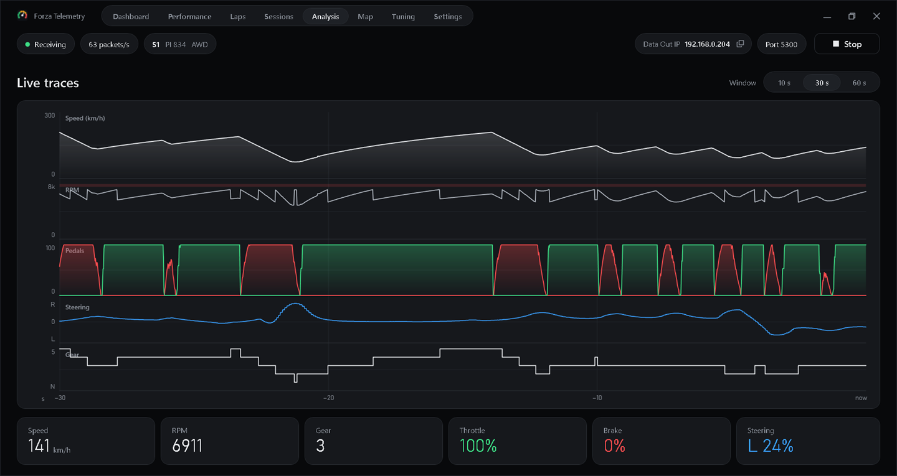
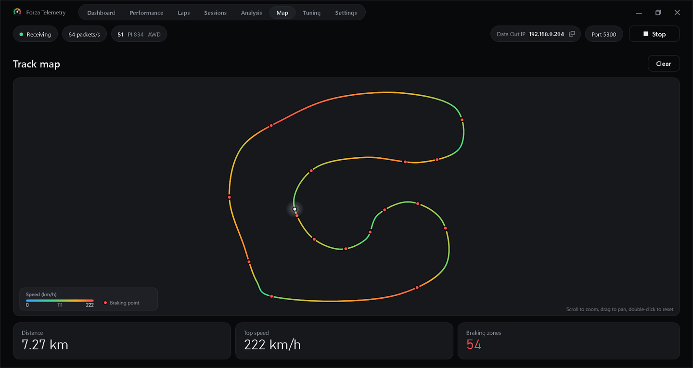
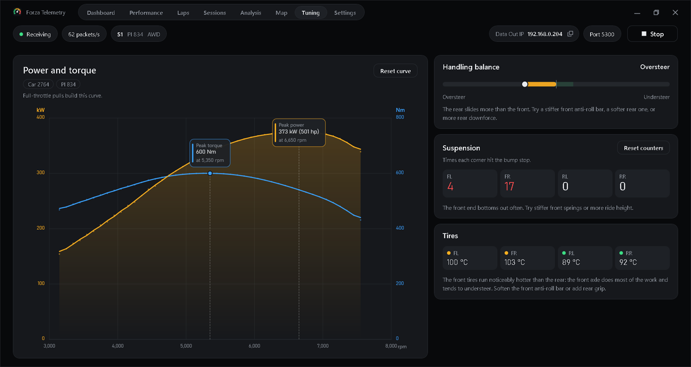
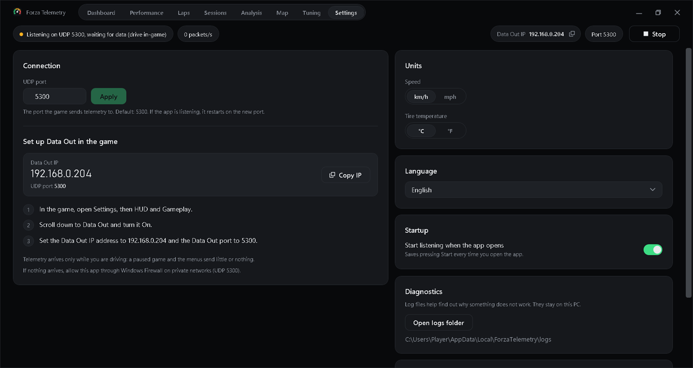

# Forza Telemetry

A live telemetry app for Forza Horizon 6 on Windows. See your car, tires, shift lights, G-force, inputs and engine data in real time, time your runs and laps, record a drive and replay it later, and get tuning hints from your own numbers, all straight from the game's Data Out feature.

> *Forza Telemetry* is a working title and may change before the first release.

**Unofficial. Not affiliated with or endorsed by Microsoft, Xbox Game Studios, Playground Games or Turn 10. Forza and Forza Horizon are trademarks of Microsoft.**

## Features

Eight tabs, each one keyboard-reachable with Ctrl+1 to Ctrl+8:

| Tab | What it does |
| --- | --- |
| **Dashboard** | The car at a glance: tire temperatures, shift lights, gear and speed, pedal and steering inputs, G-force, engine gauges. |
| **Performance** | Times 0-100 and 0-200 km/h, the quarter mile and your top speed, and keeps the best of each per car. |
| **Laps** | Best, last and current lap with a live delta against your best, and the list of every lap. |
| **Sessions** | Records what the game sends to a file and plays it back later at 0.5x to 4x, driving every other tab as if it were live. Rename, delete and open the folder from here. |
| **Analysis** | Live speed, RPM, throttle, brake and steering traces over the last seconds, stacked on one time axis. |
| **Map** | The path you drove, colored by speed, with braking points marked. Works on live data and on replays. |
| **Tuning** | Power and torque curves captured from your full-throttle pulls, plus understeer and oversteer, tire temperature and suspension bottoming hints. |
| **Settings** | UDP port, units (km/h or mph, Celsius or Fahrenheit), language (English or Spanish), listening on launch, this PC's IP address and a step-by-step Data Out guide, with a warning if Windows treats your network as Public. |

## Screenshots

All screenshots show synthetic telemetry, not a real drive.

















## Requirements

- Windows 10 or 11, 64-bit.
- Forza Horizon 6 on PC, or on Xbox connected to the same local network as the PC.

No .NET install is needed: the installer is self-contained.

## Install

1. Download the latest `ForzaTelemetry-Setup-<version>.exe` from the [GitHub Releases](../../releases) page.
2. Run it. It asks for administrator rights because it adds a Windows Firewall rule for the telemetry port.
3. Verify the download against the SHA-256 file published next to it, if you like.

Early builds are not code-signed, so Windows SmartScreen may warn that the publisher is unknown. Choose **More info**, then **Run anyway** if you trust the source.

## Set up the game

Short version:

1. In the game open **Settings**, then **HUD and Gameplay**.
2. Turn **Data Out** on.
3. Set **Data Out IP Address** to the address shown in the app.
4. Set **Data Out IP Port** to `5300`.

The game only sends packets while you are driving, so nothing shows up in menus or while paused.

Xbox: the console and the PC must be on the same network (wired or Wi-Fi). If you use a VPN on the PC, enable its "LAN access" option. The installer creates a Windows Firewall rule for UDP 5300 on private networks by default (an optional, not recommended installer task also allows public networks).

Full step-by-step guide with troubleshooting: [docs/data-out-setup.md](docs/data-out-setup.md).

## Build from source

Requires the .NET 10 SDK on Windows.

```powershell
dotnet build ForzaTelemetry.slnx
dotnet test ForzaTelemetry.slnx
installer/build.ps1 -Version 0.1.0   # needs Inno Setup 6; writes the installer to dist/
```

## Architecture

- `ForzaTelemetry.Core`: pure telemetry model and packet parsing, no I/O.
- `ForzaTelemetry.Udp`: UDP listener that feeds packets to Core.
- `ForzaTelemetry.App`: the WPF application (MVVM), the composition root.
- `ForzaTelemetry.Console`: a small command-line tool that prints live telemetry, useful for debugging.

## License

Source-available under the [PolyForm Strict License 1.0.0](LICENSE). You may read and learn from the code and use the app for noncommercial purposes, but you may not modify, copy or redistribute it. This is not an open-source license.

## Credits

Built with .NET, WPF, CommunityToolkit.Mvvm and Serilog. See [THIRD-PARTY-NOTICES.txt](THIRD-PARTY-NOTICES.txt) for the third-party licenses.
